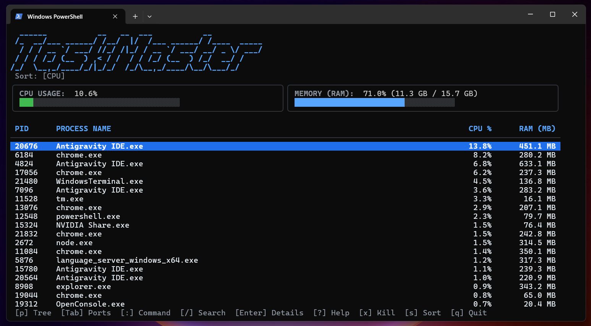

# TaskMaster (tm)

<p align="center">
  
</p>

TaskMaster (`tm`) is a lightweight, cross-platform terminal task manager engineered with Go. It delivers real-time system resource tracking, non-blocking interactive command execution, deep process inspection, and customizable themes while maintaining minimal CPU and memory overhead.

---

## Overview

Modern graphical task managers often consume hundreds of megabytes of RAM and require separate window contexts. Traditional terminal tools like `top` or standard Windows Tasklist can be rigid, difficult to script, or lacking intuitive interactive controls.

TaskMaster bridges this gap by combining the speed and efficiency of a compiled Go binary with a rich Terminal User Interface (TUI) powered by the Elm-architecture event loop. It allows operators and developers to monitor system health, inspect detailed process metadata, filter running processes, and terminate unresponsive tasks without leaving their terminal environment.

---

## Core Features

- **Resource Efficiency:** Idles at less than 1% CPU utilization and typically consumes between 10 MB and 15 MB of resident memory.
- **Asynchronous Event Loop:** Metric gathering, hardware polling, and terminal rendering execute asynchronously without blocking user keystrokes in the interactive command prompt.
- **Dynamic In-App Command Prompt:** Activate the interactive input bar using `:` to execute administrative commands or `/` for instantaneous live process filtering.
- **Detailed Process Inspection:** Drill down into any highlighted process with `Enter` to examine its Process ID, Parent Process ID, thread count, memory footprint, executable path, and launch arguments.
- **Instant Process Termination:** Terminate misbehaving tasks directly from the interactive table using `x` or via the command bar (`:kill <pid>`).
- **Global Terminal Registration:** A dedicated installer subcommand (`tm install`) writes binary path configurations directly into the Windows User Environment Registry, enabling execution from any newly launched Command Prompt or PowerShell session.
- **Modular Theme Engine:** Switch color schemes on the fly between pre-configured palettes including Default, Nord, Dracula, Matrix, and Cyberpunk.
- **Non-Interactive Scriptable CLI:** Export tabular process data directly to standard output for pipeline operations and automated scripts via `tm list`.

---

## Architecture

TaskMaster is organized into isolated packages adhering to standard Go project conventions:

```text
CMDTaskManager/
├── cmd/
│   ├── root.go             # Root command definition, flags, and TUI lifecycle
│   ├── kill.go             # Non-interactive CLI kill subcommand
│   ├── list.go             # Non-interactive CLI process snapshot subcommand
│   └── install.go          # Windows User PATH registry automation
├── internal/
│   ├── metrics/
│   │   ├── system.go       # CPU and RAM metric acquisition routines
│   │   └── process.go      # Process enumeration, sorting, filtering, and WinAPI termination
│   ├── theme/
│   │   └── theme.go        # Color definitions, Lipgloss styles, and theme registry
│   └── ui/
│       ├── commandbar.go   # Interactive bottom input and status notification bar
│       ├── sparkline.go    # Progress bar and Unicode gauge rendering utilities
│       └── model.go        # Main Bubble Tea model, keyboard router, and modal overlays
├── go.mod
├── go.sum
└── main.go                 # Application entry point
```

---

## Keybindings Reference

### Table Navigation & Inspection

| Key | Description |
| :--- | :--- |
| `Up` / `k` | Move cursor selection up |
| `Down` / `j` | Move cursor selection down |
| `PageUp` | Move cursor up by 10 rows |
| `PageDown` | Move cursor down by 10 rows |
| `Home` / `g` | Jump to the top of the process list |
| `End` / `G` | Jump to the bottom of the process list |
| `Enter` | Open the comprehensive process inspection modal |

### Commands & Controls

| Key | Description |
| :--- | :--- |
| `/` | Open live search input to filter processes by name or PID |
| `:` | Open interactive command bar |
| `s` | Cycle process sorting order (CPU -> RAM -> PID -> Name) |
| `t` | Cycle color theme (Default -> Nord -> Dracula -> Matrix -> Cyberpunk) |
| `x` / `K` | Terminate the currently selected process |
| `?` / `h` | Open the full command and keybinding guide modal |
| `q` / `ESC` | Clear active filter, dismiss modal, or exit application |
| `Ctrl+C` | Force quit immediately |

---

## In-App Commands (Command Bar)

Press `:` at any point to activate the interactive prompt. The following commands can be executed:

| Command | Arguments | Description |
| :--- | :--- | :--- |
| `:kill` | `<PID>` | Terminate process with the specified PID. If no PID is given, terminates the currently selected process. |
| `:info` | `[PID]` | Open process inspection modal for the given PID or selected process. |
| `:sort` | `cpu` \| `mem` \| `pid` \| `name` | Re-sort the process list by the specified attribute. |
| `:theme` | `default` \| `nord` \| `dracula` \| `matrix` \| `cyberpunk` | Switch active visual theme. |
| `:filter` | `<query>` | Filter process table by name or PID substring. |
| `:clear` | None | Clear active search filter and restore full process list. |
| `:pause` | None | Freeze live metrics updates to examine current state. |
| `:resume`| None | Unfreeze and resume periodic metric ticks. |
| `:help`  | None | Open the interactive guide modal. |
| `:q`     | None | Exit TaskMaster. |

---

## Installation & Setup

### Prerequisites

- Go compiler (version 1.25 or higher recommended)
- Windows 10/11, Windows Server, or PowerShell/CMD environments

### Building from Source

1. Clone the repository:
   ```powershell
   git clone https://github.com/SametERILTER/Task-Master.git
   cd Task-Master
   ```

2. Download and verify Go dependencies:
   ```powershell
   go mod tidy
   ```

3. Compile the executable:
   ```powershell
   go build -o tm.exe main.go
   ```

4. Launch TaskMaster locally:
   ```powershell
   .\tm.exe
   ```

### Global PATH Installation

To launch TaskMaster from any directory or terminal session by typing `tm`:

1. Execute the built-in installer:
   ```powershell
   .\tm.exe install
   ```

2. The installer will:
   - Copy `tm.exe` into `%LOCALAPPDATA%\Programs\tm\tm.exe`.
   - Safely update the Windows User Environment Registry (`HKCU\Environment\Path`).
   - Enable `tm` execution across any newly opened Command Prompt or PowerShell window.

---

## CLI Subcommands and Parameters

TaskMaster functions both as an interactive TUI dashboard and as a scriptable command-line utility.

### Running with Startup Flags

```powershell
# Launch directly sorted by Memory usage with Nord theme
tm --sort mem --theme nord

# Launch with pre-applied filter for Chrome processes
tm --filter chrome
```

### Fast Process Snapshot (`tm list`)

Dump active processes directly to stdout and exit without launching the full TUI:

```powershell
# List top 20 processes sorted by CPU
tm list

# List top 10 processes sorted by Memory
tm list --sort mem -n 10
```

Output format:
```text
PID      PROCESS NAME                        CPU %       RAM (MB)
----------------------------------------------------------------
18732    go.exe                              45.3%         26.9 MB
13284    powershell.exe                      20.0%         64.2 MB
7844     main.exe                            19.5%         10.2 MB
```

### Direct Process Termination (`tm kill`)

Terminate a process directly from your shell without opening the UI:

```powershell
tm kill 4920
```

---

## Available Themes

| Theme Name | Style Characteristics |
| :--- | :--- |
| `default` | Calm blue accents (`#58A6FF`), crisp silver text, seamless native terminal background integration. |
| `nord` | Arctic, pastel-blue tones (`#88C0D0`, `#81A1C1`) with subdued borders. |
| `dracula` | Elegant purple (`#BD93F9`) and soft pink (`#FF79C6`) highlights. |
| `matrix` | Classic hacker green (`#00FF66`) monospace aesthetic. |
| `cyberpunk` | High-contrast neon cyan (`#00F0FF`) and bright yellow (`#FFE600`). |

---

## Contributing

Contributions, bug reports, and feature requests are welcome.

1. Fork the repository.
2. Create your feature branch (`git checkout -b feature/new-widget`).
3. Commit your modifications (`git commit -m 'feat: add network traffic widget'`).
4. Push to the branch (`git push origin feature/new-widget`).
5. Open a Pull Request.

---

## Contact

- Email: sametbilal34@gmail.com

---

## License

This project is licensed under the MIT License. See the LICENSE file for details.
